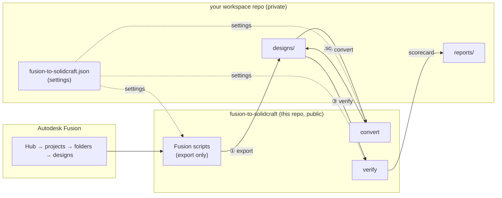
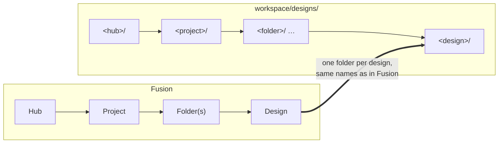
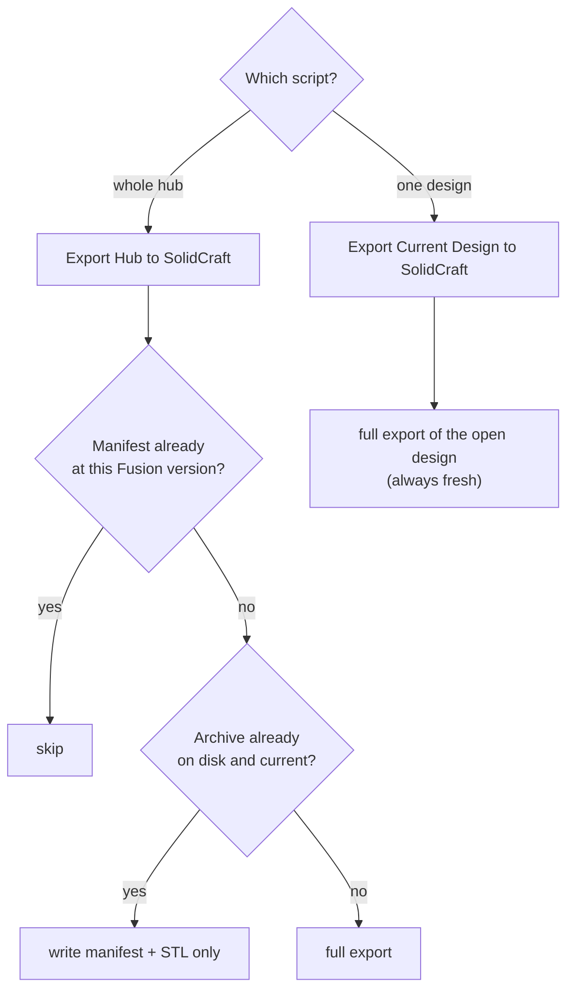
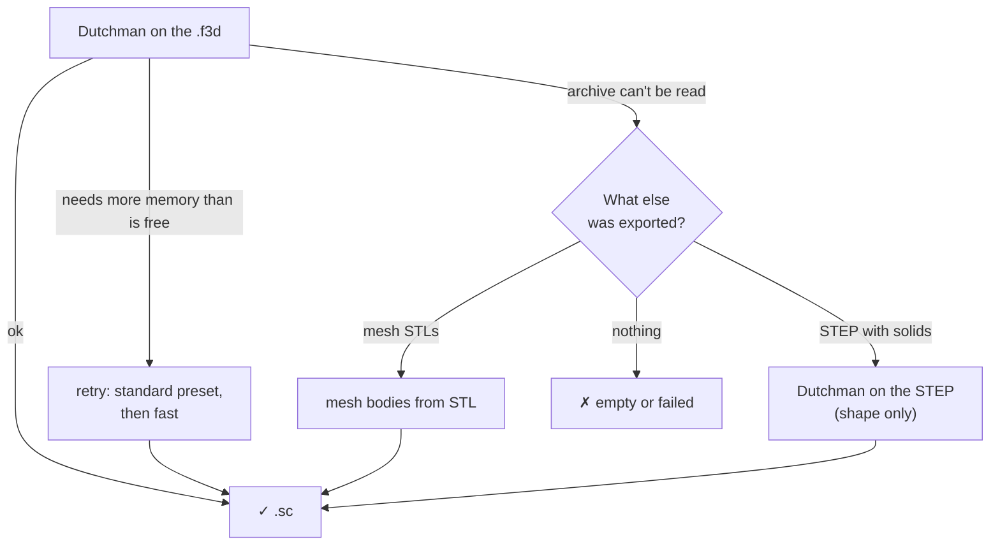

# fusion-to-solidcraft

Move your Autodesk Fusion designs into [SolidCraft](https://github.com/tangency-labs/solidcraft), keeping as much parametric history as SolidCraft can replay, and **prove** nothing was lost.

- **Fusion only exports.** Everything after that runs outside Fusion, under your control.
- **Two repos.** This public repo holds the tools. Your designs live in your own private **workspace** repo.
- **Nothing is trusted blindly.** Every converted design is measured against Fusion's own numbers.

## How it works



| Step | Runs in | What it does |
|---|---|---|
| ① Export | Fusion | Saves each design's files and its ground-truth numbers |
| ② Convert | Terminal | Turns each design into a SolidCraft `.sc` |
| ③ Verify | Terminal | Compares each `.sc` with Fusion's numbers and writes a scorecard |

## Requirements

- Autodesk Fusion, for the export only
- [Dutchman](https://github.com/dutchman-cad/dutchman), the Fusion → SolidCraft converter: `brew install dutchman-cad/tap/dutchman`
- `solidcraft-cli`, which converts meshes and measures designs
- Python 3.9+ (stdlib only)

## Quick start

1. Clone this repo **next to** your workspace repo.
2. Add a `fusion-to-solidcraft.json` to your workspace ([settings](#workspace-settings)).
3. `make install-fusion` adds the export scripts to Fusion.
4. In Fusion, go to *Utilities → Scripts and Add-Ins → **Export Hub to SolidCraft** → Run*.
5. From your workspace, run `convert/convert.py`, then `verify/check.py`, or use a Makefile that wraps them.
6. Read `reports/scorecard.md`.

## ① Export: where it writes and what

All output goes into **your workspace**, never into this repo.



**In each design's folder:**

| File | What it is | Used for |
|---|---|---|
| `<design>.f3d` | The Fusion archive: history, sketches, parameters, geometry | Converting, and keeping the original |
| `<design>.step` | Fusion's STEP export, including any designs it references | Geometry reference, and a fallback for converting |
| `meshes/NN-<body>.stl` | One STL per visible mesh body (only when the design has mesh bodies) | Converting mesh bodies |
| `manifest.json` | Fusion's own numbers (below) | The ground truth for verify |
| `versions/<design>.vN.f3d` | Past Fusion versions (only with `all_versions`) | History you can go back to |

**What `manifest.json` records:**

- Fusion's id, version and name for the design, and whether it's parametric
- User parameters: name, expression, value, unit and comment
- The timeline: every feature's name, type, suppressed state and health
- Sketches: curve, constraint and dimension counts, and whether each is fully constrained
- Bodies and mesh bodies: names, visibility, volume, area, overall bounding box
- Components, occurrences, joints, and the other designs it references
- `errors`: anything Fusion wouldn't report, such as parameters in a direct-modelling design. A note here never fails the export

**In `reports/`:**

- `export.log`: every run, every design (hub export)
- `export-summary.json`: the last hub run's exported, reused, skipped, noted and failed designs
- `export-current.log`: runs of the single-design script

### The two Fusion scripts



- **Export Hub to SolidCraft**
  - Asks for the workspace path once and remembers it.
  - Asks which hub, pre-filled with your last choice.
  - Safe to stop and re-run: finished designs are skipped.
- **Export Current Design to SolidCraft**
  - Exports the design open in Fusion, then shows the command to convert and verify it.
  - The quick loop for working on one design.
- **Both**
  - Choices are remembered in `fusion/lib/export_config.local.json`, which is untracked. One-off overrides such as `"limit": 5` go there too.
  - A design fails only if its `.f3d` can't be written.

## ② Convert

Run it from the workspace, or pass `--workspace` or set `$F2S_WORKSPACE`.



- **Writes beside each design:**
  - `<design>.sc`: the SolidCraft design you edit from now on
  - `<design>.dutchman.json`: the machine report. Its `f2s` block says which method made the `.sc` and why
  - `<design>.dutchman.txt`: every loss, explained
- **Options:**
  - `--only <text>` or `--design <folder>`: just some designs
  - `--force`: re-convert, for example after a tool upgrade
- **History:** a design keeps editable history up to the first feature SolidCraft can't replay yet. After that, the exact final shape is imported.

## ③ Verify

- **Measures** each `.sc` with `solidcraft-cli eval` and compares it with `manifest.json`:
  - volume (within 0.1%), body count and bounding box
  - parameter names and expressions
- **No manifest yet?** It checks geometry against Fusion's STEP instead.
- **Partial designs:** the hidden history copy is left out, so only the final shape is measured.
- **Writes** `reports/scorecard.md` and `reports/scorecard.csv`. A subset run updates just its rows.

| Category | Meaning |
|---|---|
| ✅ full | Every Fusion feature became editable SolidCraft history |
| 🟡 partial | Editable history up to the first unmapped feature, then the imported final shape |
| 🟠 geometry | Shape only, no editable history (includes STEP conversions) |
| 🔷 mesh | Mesh bodies only |
| ⚪ empty | Nothing to convert: no solids, surfaces or meshes in Fusion |
| ❌ failed | No `.sc`, or SolidCraft can't evaluate it |

## Workspace settings

`fusion-to-solidcraft.json` at the root of your workspace:

```json
{
  "hub": "My Hub",
  "designs_dir": "designs",
  "reports_dir": "reports",
  "export": { "projects": [], "all_versions": false, "export_step": true },
  "versions": { "dutchman": "0.2.7", "solidcraft-cli": "0.30.1" }
}
```

| Key | Meaning |
|---|---|
| `hub` | The default hub to pre-fill |
| `designs_dir`, `reports_dir` | Where output goes, relative to the workspace |
| `export.projects` | Only these projects. Empty means all |
| `export.all_versions` | Also export every past version. Much slower |
| `export.export_step` | Write the STEP copy (keep this on: verify and convert use it) |
| `versions` | The tool versions your `.sc` files were made with. Convert and verify warn if what's installed differs |

Use Git LFS for the CAD files in your workspace (`*.f3d *.sc *.step *.stl`).

## Limits

- Fusion's **version history** is kept as archives, not as SolidCraft history.
- **T-splines (Form), CAM, simulation and drawings** don't come across. SolidCraft hasn't built them yet.
- **Appearances** come across as colours only.
- **Coverage grows** with each Dutchman and SolidCraft release: upgrade, re-run convert with `--force`, then verify.

## License

MIT
