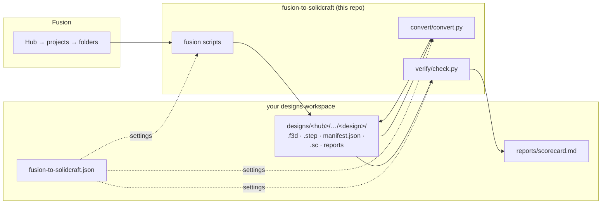

# fusion-to-solidcraft

Move your Autodesk Fusion designs into [SolidCraft](https://github.com/tangency-labs/solidcraft)
with as much of their parametric history as SolidCraft can replay, and check that
nothing was lost.

This repo holds only the **tools**. Your designs live in a separate **workspace**: any
folder or repo with a `fusion-to-solidcraft.json` at its root. The tools read their
settings from that file and write only into the workspace. That keeps the tools generic
and public, and your designs private.



## Requirements

- Autodesk Fusion (for the export only)
- [Dutchman](https://github.com/dutchman-cad/dutchman), which does the Fusion → SolidCraft conversion: `brew install dutchman-cad/tap/dutchman`
- `solidcraft-cli`, which Dutchman uses to check its output and `verify` uses to measure it
- Python 3.9+ (stdlib only)

## Set up a workspace

Create a `fusion-to-solidcraft.json` at the root of your designs repo:

```json
{
  "hub": "My Hub",
  "designs_dir": "designs",
  "reports_dir": "reports",
  "export": { "projects": [], "all_versions": false, "export_step": true },
  "versions": { "dutchman": "0.2.7", "solidcraft-cli": "0.30.1" }
}
```

| Key | Meaning |
|---|---|
| `hub` | The default Fusion hub. The export lists every hub on your account and pre-fills this one. |
| `designs_dir`, `reports_dir` | Where designs and reports go, relative to the workspace. |
| `export.projects` | Limits the export to these project names (empty means every project). |
| `export.all_versions` | Also exports every past Fusion version into each design's `versions/` folder. Much slower. |
| `versions` | The tool versions the workspace's `.sc` files were made with. `convert` and `verify` warn when the installed tools differ. |

If the workspace is a git repo, track the CAD binaries with Git LFS (`*.f3d *.f3z *.sc *.step`).

## Run it

Fusion only **exports**. Conversion and verification run outside Fusion, from the
workspace, so that part stays scriptable, testable and fully under your control.

1. **Export (in Fusion).** Run `make install-fusion` once. It adds two scripts under
   Fusion's *Utilities → Scripts and Add-Ins*:
   - **Export Hub to SolidCraft** exports every design in a hub. The first run asks for the
     workspace path, pre-filled with a sibling folder that has the marker file. Every run asks
     which hub to export. Both answers are remembered in `fusion/lib/export_config.local.json`
     (untracked), which is also where one-off overrides go, such as `"limit": 5`. Re-running
     is safe: a design whose Fusion version hasn't changed is skipped, and if a design's archive
     is already on disk but its manifest is missing, only the manifest is written.
   - **Export Current Design to SolidCraft** exports just the design open in Fusion, always
     fresh, and shows the command to convert and verify it. This is the quick loop for one design.

   Each design gets its `.f3d` archive, a STEP copy, its mesh bodies as STL under `meshes/`,
   and a `manifest.json`. The manifest records the design's user parameters, timeline,
   sketches, bodies, mesh bodies, the other designs it references, volumes and bounding box.
   It is the ground truth for verification. A design counts as failed only when its archive
   can't be exported. A detail Fusion won't report (for example, parameters in a
   direct-modelling design) is listed under the manifest's `errors` instead.
2. **Convert.** Run `convert/convert.py` from the workspace (or pass `--workspace`, or set
   `$F2S_WORKSPACE`). `--only <text>` or `--design <folder>` limits the run to some designs,
   and `--force` re-converts after a tool upgrade. It writes `<design>.sc` beside each
   archive, plus `.dutchman.json`, which has an `f2s` block recording which method made the
   `.sc` and why, and `.dutchman.txt` with every loss explained. Methods, tried in order:

   | Method | When |
   |---|---|
   | `archive` | Dutchman on the `.f3d`. Editable history up to the first feature SolidCraft can't replay yet, then the exact final shape |
   | `archive-standard`, `archive-fast` | The requested preset needs more memory than is free |
   | `mesh` | The archive holds only mesh bodies, which Dutchman can't decode. The exported STLs become mesh bodies |
   | `step` | The archive has no readable geometry but Fusion's STEP does. Typically a design that references other designs, which Fusion's API archives without their geometry. Shape only |

3. **Verify.** `verify/check.py` measures each `.sc` with `solidcraft-cli eval` and compares
   it with the manifest: volume (within 0.1%), body count, bounding box, and parameters with
   their expressions. A design with no manifest is checked for geometry only, against
   Fusion's own STEP export. For a partial design, the hidden history bodies are left out,
   so only the final shape is measured. It writes `scorecard.csv` and `scorecard.md` (a
   subset run updates just its rows). The scorecard records the tool versions and this
   repo's commit, groups designs into the categories below, and names each design's first
   blocking feature.

   | Category | Meaning |
   |---|---|
   | full | Every Fusion feature became editable SolidCraft history |
   | partial | History up to the first unmapped feature, then the imported final shape |
   | geometry | Shape only, no editable history (includes `step` conversions) |
   | mesh | Mesh bodies only |
   | empty | Nothing to convert: no solids, surfaces or meshes in the Fusion design |
   | failed | No `.sc`, or SolidCraft can't evaluate it |

## Limits

Fusion's version history becomes archives, not SolidCraft history. T-splines (Form), mesh,
CAM, simulation and drawings aren't supported by SolidCraft yet. Appearances come across
as colours only. Coverage improves with each Dutchman and SolidCraft release, so re-convert
now and then.

## License

MIT
